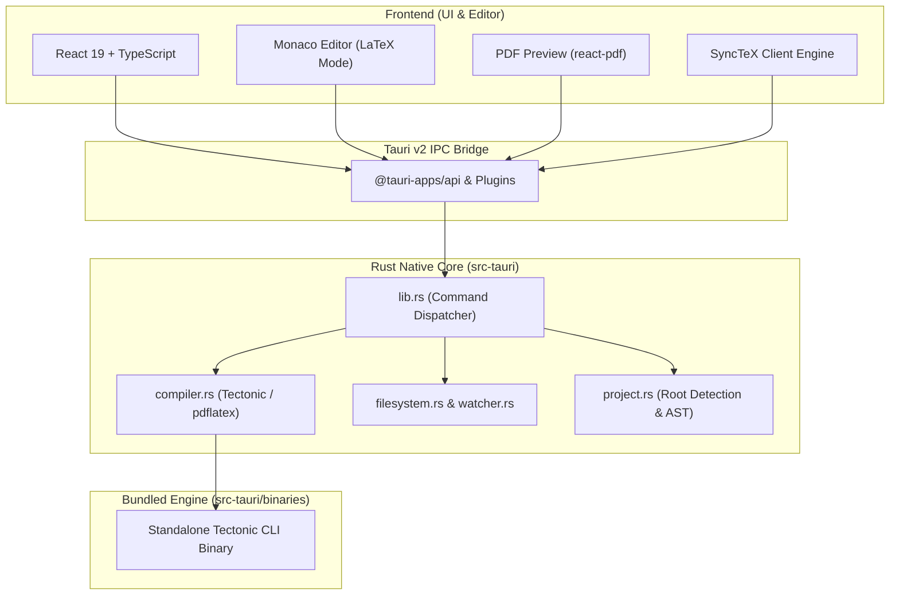

# Tiya — Local Development & Architecture Guide

This guide covers everything you need to set up, develop, test, build, and debug **Tiya** locally on your machine.

---

## 1. Architecture Overview

Tiya is a local, privacy-first desktop LaTeX editor built with **Tauri v2** and **React 19**.



### Core Layers

1. **Frontend (`src/`)**:
   * **`src/App.tsx`**: Main workspace coordinator handling resizable panes, active document state, and compiler feedback.
   * **`src/components/CodeEditor.tsx`**: Monaco Editor configured for LaTeX syntax highlighting, bracket colorization, and code-to-PDF SyncTeX jump events.
   * **`src/components/PDFPreview.tsx`**: High-DPI PDF canvas viewer supporting zoom, page navigation, and PDF-to-code SyncTeX clicks.
   * **`src/components/Sidebar.tsx`**: Project file tree, document switcher, asset manager, and template gallery.
   * **`src/hooks/useCompiler.ts`**: Manages build triggers, stream diagnostics, and intermediate file caches.
   * **`src/hooks/useDocuments.ts`**: Tab lifecycle, unsaved state tracking, external file change detection, and recovery.
   * **`src/hooks/useSynctex.ts`**: Bidirectional coordinate mapping between source lines and PDF viewports.

2. **Backend (`src-tauri/src/`)**:
   * **`compiler.rs`**: Invokes the embedded Tectonic binary (or system `pdflatex`), streaming build logs and stdout to the frontend in real time.
   * **`filesystem.rs`**: Safe sandboxed local file operations, file creation, deletion via OS trash, and asset streaming.
   * **`project.rs`**: Multi-file LaTeX parsing, root document discovery (`\documentclass`, `\input`, `\include`), and project structure analysis.
   * **`watcher.rs`**: File-system watching using the Rust `notify` crate to detect edits made by external tools or git.

3. **Compiler Sidecar (`src-tauri/binaries/`)**:
   * Bundled standalone Tectonic executable (e.g. `tectonic-aarch64-apple-darwin` on Apple Silicon). Packaged directly into the `.app`/`.dmg` so users never need to install TeX Live or MacTeX.

4. **Landing Page & Documentation (`docs/`)**:
   * Independent public documentation and download portal deployed via GitHub Pages.

---

## 2. Prerequisites & Environment Setup

### Required Tools

| Tool | Recommended Version | Purpose | Installation Command |
| :--- | :--- | :--- | :--- |
| **Node.js** | `>= 20.x` | Frontend runtime | Installed via `nvm` or [nodejs.org](https://nodejs.org/) |
| **npm** | `>= 10.x` | Package manager | Bundled with Node |
| **Rust & Cargo** | `stable (1.78+)` | Native backend compilation | `curl --proto '=https' --tlsv1.2 -sSf https://sh.rustup.rs \| sh` |
| **Xcode CLI Tools** | Latest | macOS C/C++ compiler toolchain | `xcode-select --install` |

### Setting Up Rust on macOS (If Not Installed)

If `cargo` is not in your terminal PATH:
```bash
# 1. Install Rust via official rustup
curl --proto '=https' --tlsv1.2 -sSf https://sh.rustup.rs | sh

# 2. Source cargo environment
source "$HOME/.cargo/env"

# 3. Verify installation
cargo --version
rustc --version
```

### Linux Build Prerequisites
```bash
sudo apt-get update
sudo apt-get install -y build-essential curl wget file libssl-dev libgtk-3-dev libwebkit2gtk-4.1-dev libappindicator3-dev librsvg2-dev
```

### Windows Build Prerequisites
* Microsoft Visual Studio 2022 with C++ desktop development workload.
* WebView2 runtime (pre-installed on Windows 10/11).

---

## 3. Getting Started

### 1. Clone & Install Dependencies

```bash
git clone https://github.com/saqib40/tiya.git
cd tiya

# Install node dependencies
npm install
```

### 2. Verify Bundled Tectonic Sidecar

Tiya expects the platform-specific Tectonic binary in `src-tauri/binaries/`:
* **macOS (Apple Silicon):** `src-tauri/binaries/tectonic-aarch64-apple-darwin`
* **macOS (Intel):** `src-tauri/binaries/tectonic-x86_64-apple-darwin`
* **Linux (x86_64):** `src-tauri/binaries/tectonic-x86_64-unknown-linux-gnu`
* **Windows (x64):** `src-tauri/binaries/tectonic-x86_64-pc-windows-msvc.exe`

Ensure the binary has executable permissions on Unix systems:
```bash
chmod +x src-tauri/binaries/tectonic*
```

---

## 4. Local Development Workflows

You can develop using two workflows depending on what you are changing:

### Workflow A: Rapid Frontend UI Development (Browser)

Use this when modifying UI components, CSS styling, theme colors, or Monaco editor behaviors:

```bash
npm run dev
```

* Starts the Vite development server at **`http://localhost:1420`**.
* Features **Hot Module Replacement (HMR)** — editing any `.tsx` or `.css` file updates the browser immediately without losing state.
* *Note:* Native desktop capabilities (like OS file picker dialogs or direct filesystem access) will log warnings or mock fallback data when viewed in a standard web browser.

### Workflow B: Full Desktop Application Development (Native Shell)

Use this when working with the full native experience, filesystem integration, Tectonic compilation, or Rust backend:

```bash
npm run tauri dev
```

* **What it does:**
  1. Starts the Vite frontend server at `http://localhost:1420`.
  2. Compiles the Rust native backend crate in `src-tauri/`.
  3. Spawns and attaches the native macOS/Windows/Linux window with active devtools.
* **Live Reloading:**
  * Changing frontend code (`src/`): Updates instantly inside the native window via HMR.
  * Changing Rust code (`src-tauri/src/`): Cargo automatically triggers an incremental recompile and relaunches the app window.

---

## 5. Testing & Quality Assurance

### Run Frontend Automated Test Suite
Tiya uses **Vitest** with `@testing-library/react` and `jsdom`:

```bash
npm run test
```

* Executes 10 test suites covering:
  * `App.test.tsx`: App shell, navigation, pane resizing.
  * `CodeEditor.test.tsx`: Monaco editor initialization, keystrokes, SyncTeX listeners.
  * `PDFPreview.test.tsx`: PDF rendering, page zoom, click-to-code navigation.
  * `Sidebar.test.tsx`: File tree, folder selection, template modal.
  * `useCompiler.test.ts`: Compiler job queuing, stream handling, error parsing.
  * `useDocuments.test.ts`: Buffer tracking, dirty-state management, save handling.
  * `latex.test.ts` & `synctex.test.ts`: Syntax parsing & SyncTeX coordinate translations.

To run tests in watch mode during development:
```bash
npx vitest
```

### Run TypeScript & Production Bundle Verification
Before committing code, verify strict TypeScript checks and Vite production minification:

```bash
npm run build
```

This runs:
1. `tsc` — Strict TypeScript type-checking across the entire codebase.
2. `vite build` — Production bundling and asset optimization into `dist/`.

### Run Backend Rust Unit Tests
To test the native backend logic:

```bash
cargo test --manifest-path src-tauri/Cargo.toml
```

---

## 6. Building Production Installers

To build the standalone release application and installers:

```bash
npm run tauri build
```

### Build Outputs by Platform:
* **macOS:**
  * `.app`: `src-tauri/target/release/bundle/macos/tiya.app`
  * `.dmg`: `src-tauri/target/release/bundle/dmg/tiya_<version>_<arch>.dmg`
* **Linux:**
  * `.deb`: `src-tauri/target/release/bundle/deb/`
  * `.AppImage`: `src-tauri/target/release/bundle/appimage/`
* **Windows:**
  * `.msi` / `.exe`: `src-tauri/target/release/bundle/msi/` or `nsis/`

---

## 7. macOS Code Signing & Notarization

Tiya is configured for Apple Developer ID signing and Apple Ticket Service notarization:

* **Configuration:** `src-tauri/tauri.conf.json` (`bundle.macOS`)
* **Entitlements:** `src-tauri/Entitlements.plist`
* **Signing Identity:**
  ```json
  "macOS": {
    "signingIdentity": "Developer ID Application: Saqib Hussain Dar (3BNY6WYGU3)",
    "hardenedRuntime": true,
    "entitlements": "Entitlements.plist"
  }
  ```

### Required Environment Variables for Notarization:
To sign and notarize during local release builds:
```bash
export APPLE_SIGNING_IDENTITY="Developer ID Application: Saqib Hussain Dar (3BNY6WYGU3)"
export APPLE_ID="your_apple_id@domain.com"
export APPLE_PASSWORD="app-specific-password"
export APPLE_TEAM_ID="3BNY6WYGU3"
```

In CI/CD, this is handled automatically via GitHub Actions in `.github/workflows/main.yml`.

---

## 8. Developing the Landing Page (`docs/`)

The public documentation and website reside in the `docs/` folder:
* **`docs/index.html`**: Semantic landing page structure.
* **`docs/style.css`**: Design system tokens, Saffron Yellow palette, typography, and card components.
* **`docs/script.js`**: Vector CAD animation engine and interactive tour.

### Run Local Docs Server:
```bash
python3 -m http.server 4321 -d docs
```
Visit **`http://localhost:4321`** to preview live documentation changes.

---

## 9. Common Troubleshooting

### 1. `command not found: cargo`
* **Cause:** Rust is either not installed or the `~/.cargo/bin` path is not sourced in your current shell.
* **Fix:**
  ```bash
  source "$HOME/.cargo/env"
  # Or add to your ~/.zshrc or ~/.bashrc:
  echo 'export PATH="$HOME/.cargo/bin:$PATH"' >> ~/.zshrc
  ```

### 2. Sidecar binary not found (`binaries/tectonic`)
* **Cause:** Tauri cannot locate the platform-suffixed Tectonic binary in `src-tauri/binaries/`.
* **Fix:** Ensure the binary matches the platform naming convention described in [Prerequisites](#3-getting-started) and has executable permissions (`chmod +x`).

### 3. Port `1420` already in use
* **Cause:** A previous instance of Vite dev server is still running in the background.
* **Fix:**
  ```bash
  lsof -ti :1420 | xargs kill -9
  ```

### 4. Git postinstall patch error
* **Cause:** `package.json` specifies `"postinstall": "patch-package"`.
* **Fix:** Run `npm install` directly to allow `patch-package` to apply necessary fixes to dependencies in `patches/`.
